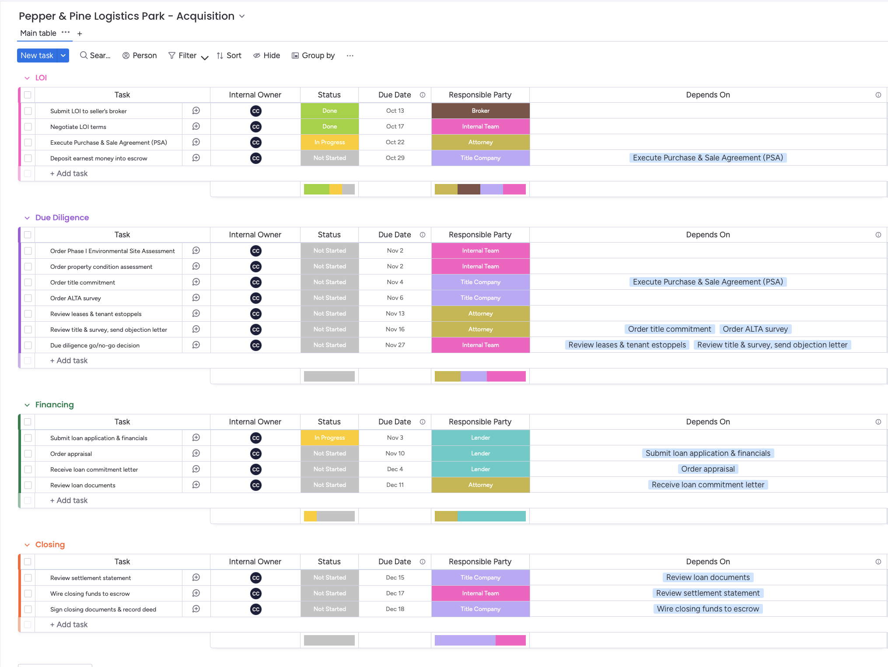
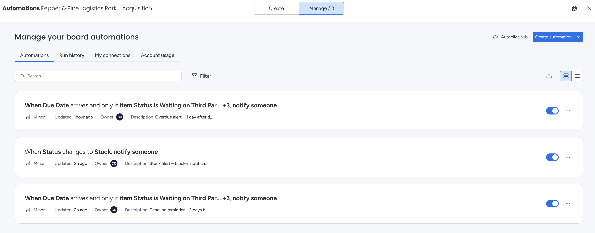
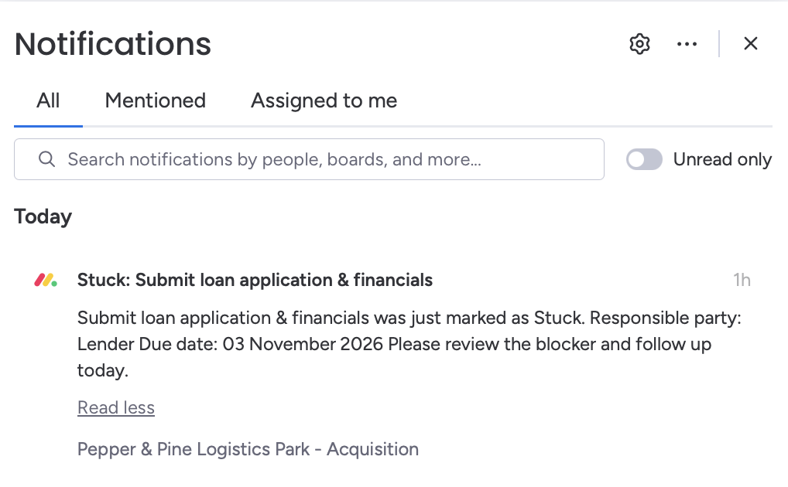
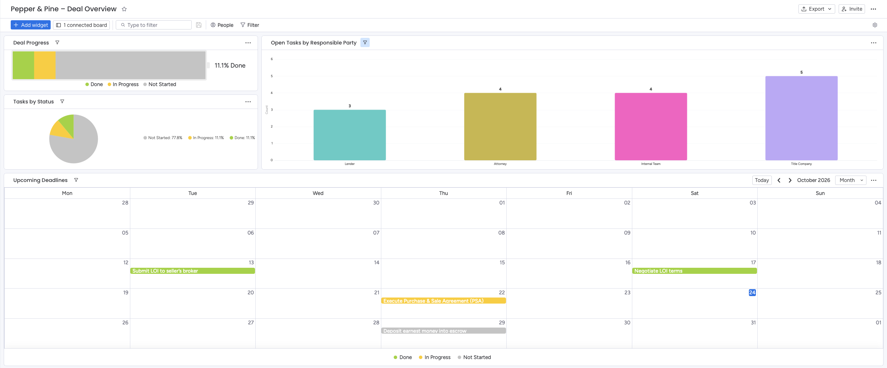

# CRE Acquisition Tracker | Monday.com + AI Status Agent

A commercial real estate acquisition workflow in Monday.com, plus a Python agent that turns the board into a weekly executive status for the COO.

- **Built by:** Camila Carrasquilla · 2026
- **Tools:** Monday.com · Python · Claude API · Jira (Scrum)
- **Deal (fictional):** Pepper & Pine Logistics Park, a $6.4M industrial property

## In 3 minutes

**The problem:** The board has all the data, but the COO doesn't have time to review 18 tasks to find what matters. Someone has to dig through it every week and write the status update by hand.

**The solution:** I built a Python agent that reads the Monday CSV export, flags overdue and upcoming tasks, and uses the Claude API to draft a weekly executive status.

**The result:** Every week, the COO gets a short status with a summary, risks, and next steps, returned as validated JSON.

<details>
<summary><b>Sample output (real run)</b></summary>

```json
{
  "summary": "LOI is 50% complete (2 of 4 tasks). Due Diligence, Financing, and Closing have no completed tasks yet. Seven tasks are overdue, led by the Purchase & Sale Agreement (PSA), now 17 days late. Two downstream tasks depend on the PSA, so its execution is the priority.",
  "risks": [
    "The PSA is 17 days late. The earnest money deposit (10 days late) and the title commitment (4 days late) both depend on it.",
    "The loan application & financials are 5 days late. The appraisal, due in 2 days, depends on that submission and is at risk of slipping.",
    "The Phase I Environmental Site Assessment and property condition assessment are each 6 days late, and the ALTA survey is 2 days late, which puts the diligence schedule behind.",
    "Financing and Closing have no completed tasks, and the overdue loan application sits with the Lender."
  ],
  "next_steps": [
    "Escalate PSA execution with the Attorney to clear the first dependency.",
    "Confirm the loan application & financials submission status with the Lender to protect the appraisal order.",
    "Place the Phase I ESA and property condition assessment orders with the Internal Team.",
    "Follow up with the Title Company on the ALTA survey and, once the PSA is signed, the title commitment.",
    "Monitor the Attorney's lease and tenant estoppel review, due in 5 days."
  ]
}
```
</details>

---

# Part 1: The Monday.com workflow



---

## The problem

A commercial real estate acquisition moves through many hands: brokers, attorneys, lenders, title companies, and the internal team. Most of the people doing the work are third parties who don't live in the buyer's systems. Deadlines are contractual, and one missed step (a late appraisal, an unreviewed survey) can delay closing.

The goal was a single place where leadership can see, at a glance:

- What phase the deal is in and how far along it is
- Who is responsible for each task, internal or external
- What is blocked, what is late, and who to call today

---

## How it's structured

### Phases

The board follows the deal lifecycle, one group per phase:

**LOI → Due Diligence → Financing → Closing**

18 tasks in total, from submitting the LOI to recording the deed.

### Columns

| Column | Purpose |
|---|---|
| **Status** | Not Started · In Progress · Waiting on Third Party · Stuck · Done |
| **Due Date** | The deadline for each task |
| **Responsible Party** | Who does the work: Attorney, Broker, Lender, Title Company, or Internal Team |
| **Internal Owner** | The team member who follows up and receives alerts |
| **Depends On** | Which tasks must be finished first |

**Design decision: two owner columns.** Attorneys, lenders, and title companies aren't users in the system, so they can't be assigned directly. Splitting ownership into *Responsible Party* (who does it) and *Internal Owner* (who follows up) means every task still has a clear, accountable owner, even when the work happens outside the team.

### Dependencies

Ten dependency links map what blocks what. For example:

- The loan commitment letter depends on the appraisal, which depends on the loan application.
- The due diligence go/no-go decision depends on both the lease/estoppel review and the title & survey review.
- Closing tasks run in sequence: settlement statement → wire funds → sign and record.

**Design decision: dependency mode set to "No action."** Monday can automatically shift dates when a predecessor moves. I turned that off on purpose: in an acquisition, many deadlines are set by the purchase agreement, so the system should flag delays, not silently move dates.

---

## Automations

Three native Monday automations keep tasks owned and on schedule:

| Automation | Trigger | Condition | Action |
|---|---|---|---|
| **Deadline reminder** | 2 days before the due date (8:00 AM) | Status is not Done | Notify the Internal Owner |
| **Overdue alert** | 1 day after the due date (8:00 AM) | Status is not Done | Notify the Internal Owner |
| **Stuck alert** | Status changes to Stuck | — | Notify the Internal Owner |

Each notification includes the task name, the responsible party, the due date, and the current status, so whoever receives it knows exactly who to follow up with without opening the board. Alerts arrive in Monday and by email.

The "Status is not Done" condition prevents noise: no one gets reminded about work that's already finished.





---

## Dashboard

A leadership view built for a quick daily check-in:

- **Deal Progress:** overall completion across all 18 tasks
- **Tasks by Status:** how the work is distributed right now
- **Open Tasks by Responsible Party:** filtered to unfinished tasks, showing which party is holding the most open items (in other words, who to call first today)
- **Upcoming Deadlines:** a calendar of every due date



---

## QA notes

A few issues I caught and fixed while testing:

- **Progress was reported as 0%** because Monday's "completed" setting was still mapped to the wrong status label after I customized the labels. Tasks *waiting on third parties* were being treated as done. I remapped completion to the Done label, and the progress bar now reflects reality.
- **The overdue alert was initially set to fire before the due date** instead of after. I caught it in review and corrected it.
- **The open-tasks chart was counting finished tasks.** I added and saved a "Status is not Done" filter so it shows only open work.
- **The Stuck alert was tested live:** changing a task to Stuck triggered both the in-app notification and the email.

---

# Part 2: The AI status agent

## How it works

```
Monday CSV export → read_monday.py → status_agent.py → claude_client.py → validated JSON
```

1. **Read and clean** (`read_monday.py`): loads the CSV export, skips title, phase, header, and empty rows, and keeps the 18 tasks with their phase, status, due date, responsible party, and dependencies.
2. **Calculate the facts** (`read_monday.py`): progress by phase, overdue tasks (due before today and not Done), and upcoming tasks (due in the next 7 days, today included).
3. **Draft the status** (`status_agent.py` + `claude_client.py`): sends only those facts to the Claude API, with rules to stay grounded in the data.
4. **Validate** (`status_agent.py`): checks that the answer is valid JSON with `summary` (a string), `risks`, and `next_steps` (lists). If not, it shows a clear error instead of crashing.

---

## Design decisions

### 1. Python calculates, Claude writes
Python counts progress, finds overdue and upcoming tasks, and sends only those facts to Claude. Math in code is exact and repeatable. A language model can get a number wrong and still sound confident. Claude's job is to turn the facts into a clear status, not to decide what the facts are.

### 2. Validate types, not just keys
At first I only checked that `summary`, `risks`, and `next_steps` existed. Then, in testing, indexing a string returned the letter "T" instead of a full sentence: no crash, just wrong output (a silent bug). Now the agent also checks types (`summary` is a string, `risks` and `next_steps` are lists) and stops with a clear message if anything doesn't match.

### 3. Ground Claude in the data
During QA, Claude wrote that a task was at risk "given the PSA delay," even though no dependency was listed. It sounded plausible, but it was invented. I sent the board's `depends_on` column to Claude and added a rule: only mention or imply a dependency if it's in the data. I used the same approach for later defects (saying a phase "had not started" when one of its tasks was in progress, and suggesting owners that already existed), and re-tested each fix with 2 runs.

### 4. Warn, don't auto-fix
If the CSV has a status the script doesn't recognize, it prints a warning instead of guessing. An automatic fix would hide the problem. A warning lets a person decide.

### 5. The agent drafts, a human reviews
The output can vary between runs, so the status is a draft, not a final report. A person reviews it before it goes to the COO, and that review needs time built in before the deadline.

---

## What I'd add next

- An AI agent that posts a weekly deal summary for leadership
- A separate board view per external party, so attorneys or lenders could be given limited guest access to only their tasks
- A reusable template, so the next acquisition starts from a proven playbook instead of a blank board

---

*The property, deal, and dates are fictional and were created for this portfolio project.*
