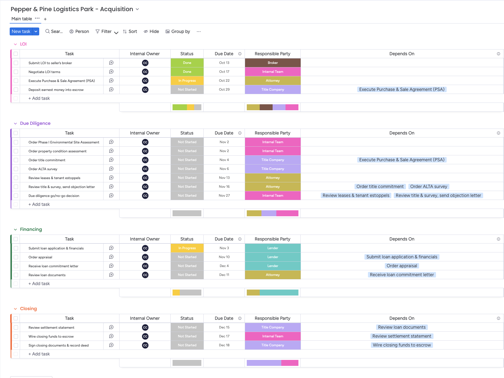
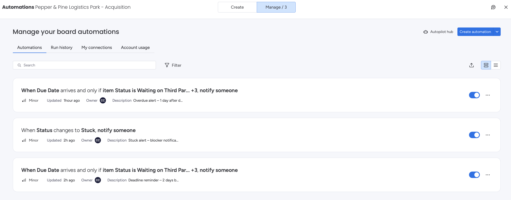
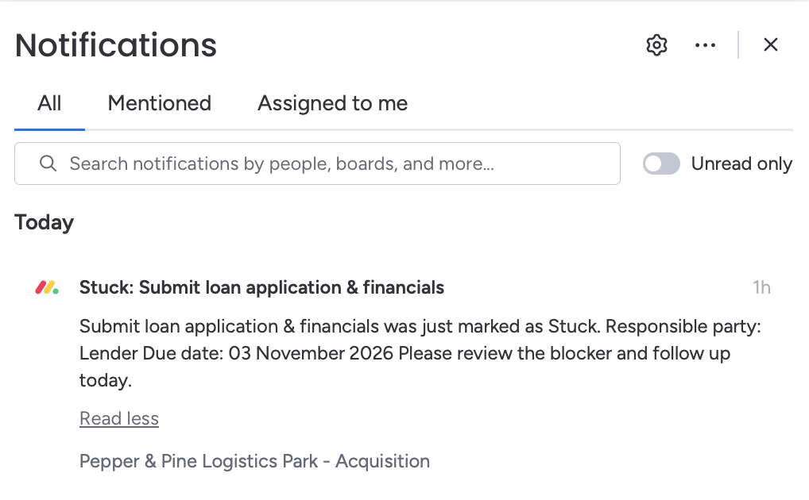
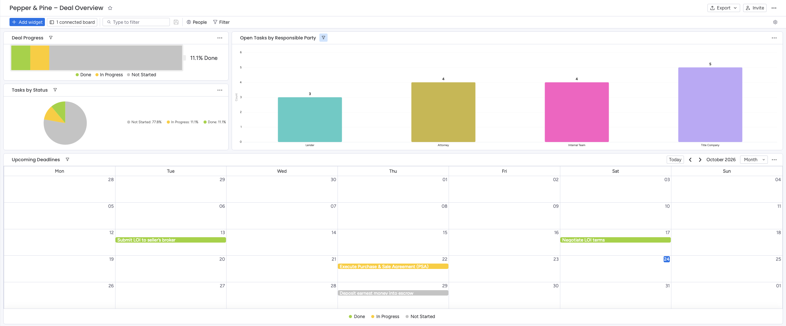

# CRE Acquisition Tracker | Monday.com

A Monday.com workflow for managing a commercial real estate acquisition, built to keep every task owned, every deadline visible, and every delay flagged before it becomes a problem.

- **Built by:** Camila Carrasquilla · 2026
- **Tool:** Monday.com (Work Management, Pro features)
- **Deal (fictional):** Pepper & Pine Logistics Park, a $6.4M industrial property

---

## The problem

A commercial real estate acquisition moves through many hands: brokers, attorneys, lenders, title companies, and the internal team. Most of the people doing the work are third parties who don't live in the buyer's systems. Deadlines are contractual, and one missed step (a late appraisal, an unreviewed survey) can delay closing.

The goal was a single place where leadership can see, at a glance:

- What phase the deal is in and how far along it is
- Who is responsible for each task, internal or external
- What is blocked, what is late, and who to call today

---

## How it's structured

### Phases

The board follows the deal lifecycle, one group per phase:

**LOI → Due Diligence → Financing → Closing**

18 tasks in total, from submitting the LOI to recording the deed.

### Columns

| Column | Purpose |
|---|---|
| **Status** | Not Started · In Progress · Waiting on Third Party · Stuck · Done |
| **Due Date** | The deadline for each task |
| **Responsible Party** | Who does the work: Attorney, Broker, Lender, Title Company, or Internal Team |
| **Internal Owner** | The team member who follows up and receives alerts |
| **Depends On** | Which tasks must be finished first |

**Design decision: two owner columns.** Attorneys, lenders, and title companies aren't users in the system, so they can't be assigned directly. Splitting ownership into *Responsible Party* (who does it) and *Internal Owner* (who follows up) means every task still has a clear, accountable owner, even when the work happens outside the team.

### Dependencies

Ten dependency links map what blocks what. For example:

- The loan commitment letter depends on the appraisal, which depends on the loan application.
- The due diligence go/no-go decision depends on both the lease/estoppel review and the title & survey review.
- Closing tasks run in sequence: settlement statement → wire funds → sign and record.

**Design decision: dependency mode set to "No action."** Monday can automatically shift dates when a predecessor moves. I turned that off on purpose: in an acquisition, many deadlines are set by the purchase agreement, so the system should flag delays, not silently move dates.

---

## Automations

Three native Monday automations keep tasks owned and on schedule:

| Automation | Trigger | Condition | Action |
|---|---|---|---|
| **Deadline reminder** | 2 days before the due date (8:00 AM) | Status is not Done | Notify the Internal Owner |
| **Overdue alert** | 1 day after the due date (8:00 AM) | Status is not Done | Notify the Internal Owner |
| **Stuck alert** | Status changes to Stuck | — | Notify the Internal Owner |

Each notification includes the task name, the responsible party, the due date, and the current status, so whoever receives it knows exactly who to follow up with without opening the board. Alerts arrive in Monday and by email.

The "Status is not Done" condition prevents noise: no one gets reminded about work that's already finished.

---

## Dashboard

A leadership view built for a quick daily check-in:

- **Deal Progress:** overall completion across all 18 tasks
- **Tasks by Status:** how the work is distributed right now
- **Open Tasks by Responsible Party:** filtered to unfinished tasks, showing which party is holding the most open items (in other words, who to call first today)
- **Upcoming Deadlines:** a calendar of every due date

---

## QA notes

A few issues I caught and fixed while testing:

- **Progress was reported as 0%** because Monday's "completed" setting was still mapped to the wrong status label after I customized the labels. Tasks *waiting on third parties* were being treated as done. I remapped completion to the Done label, and the progress bar now reflects reality.
- **The overdue alert was initially set to fire before the due date** instead of after. I caught it in review and corrected it.
- **The open-tasks chart was counting finished tasks.** I added and saved a "Status is not Done" filter so it shows only open work.
- **The Stuck alert was tested live:** changing a task to Stuck triggered both the in-app notification and the email.

---

## What I'd add next

- An AI agent that posts a weekly deal summary for leadership
- A separate board view per external party, so attorneys or lenders could be given limited guest access to only their tasks
- A reusable template, so the next acquisition starts from a proven playbook instead of a blank board

---

*The property, deal, and dates are fictional and were created for this portfolio project.*
